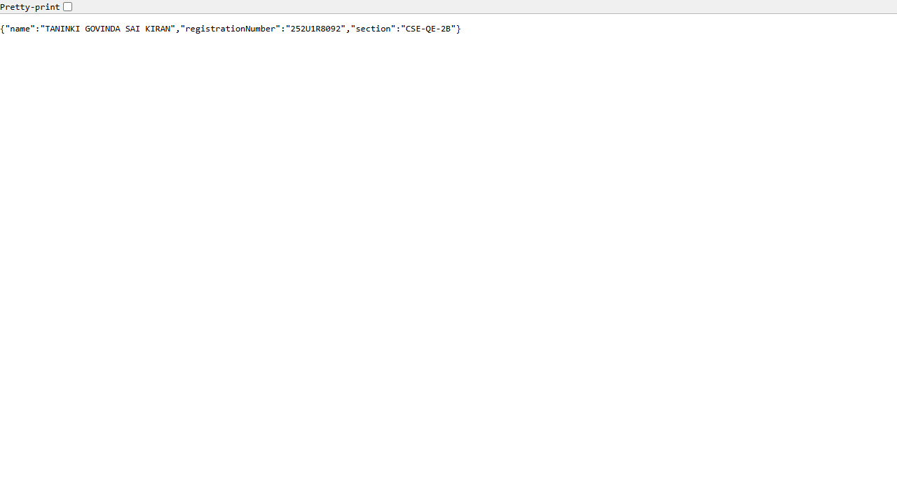
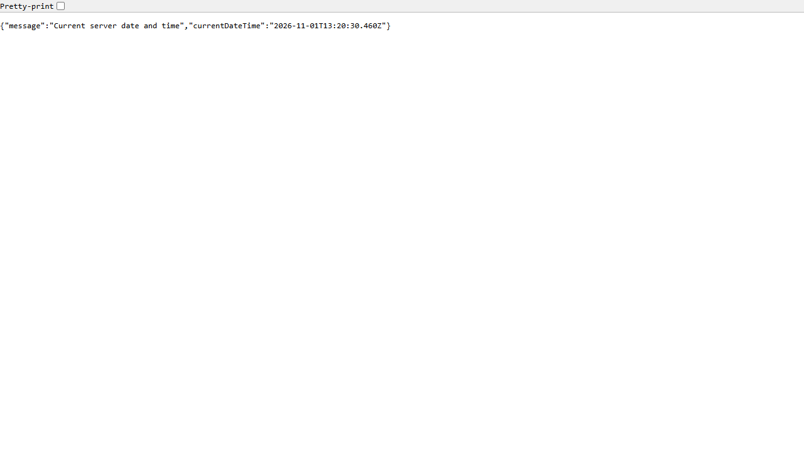
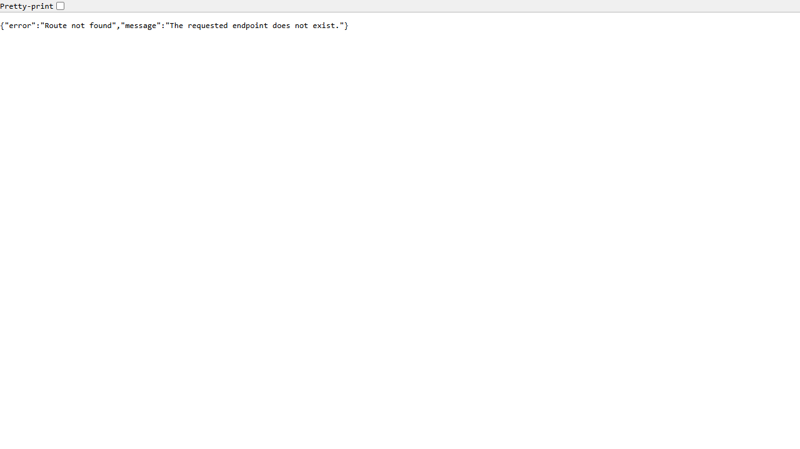

# Lab 01: Node.js and Express Server

### Student Details
- **Student Name:** TANINKI GOVINDA SAI KIRAN
- **Registration Number:** 252U1R8092
- **Section:** CSE-QE-2B
- **Course:** Backend Development Fundamentals (BDF)
- **Lab Number:** 01
- **Lab Title:** Node.js and Express Server
- **Institution:** Aurora Deemed to be University

---

## Live Deployment
- **Status:** Deployment pending (awaiting user approval checkpoint)
- **Target URL:** `https://bdf-lab-01.onrender.com` (configured on Render)
- **Deployment Platform:** Render (Free Web Service)

---

## Project Overview
This project is the complete practical submission for Backend Development Fundamentals (BDF) Lab 01. It demonstrates the fundamentals of backend web servers using Node.js:
1. Setting up a Node.js project using npm and understanding package management.
2. Creating a basic low-level HTTP web server using the built-in Node.js `http` module.
3. Upgrading to a production-grade web framework using Express.js.
4. Implementing RESTful GET routing (`/`, `/about`, `/time`).
5. Handling undefined routes with a custom 404 JSON middleware.
6. Local end-to-end testing, genuine screenshot verification, Git version control, and cloud deployment setup on Render.

---

## Objective
The primary objective of this laboratory assignment is to:
- Understand Node.js runtime environment and npm (Node Package Manager).
- Initialize a Node.js project with `package.json` and manage external dependencies like Express.
- Understand low-level HTTP transaction handling (`http.createServer`, `req`, `res`, headers, status codes).
- Learn how Express simplifies routing, request handling, response formatting, and middleware pipelines.
- Verify HTTP responses and status codes locally and on cloud hosting.

---

## Technologies Used
- **Runtime Environment:** Node.js (v24.13.1)
- **Package Manager:** npm (v11.8.0)
- **Backend Framework:** Express.js (v5.3.0)
- **Language:** JavaScript (CommonJS)
- **Version Control:** Git & GitHub
- **Hosting / Deployment:** Render (Cloud Application Hosting)

---

## Project Structure
```text
Backend_Development_Labs/
├── .gitignore
├── README.md
└── lab-01/
    ├── .gitignore
    ├── package.json
    ├── package-lock.json
    ├── http-server.js
    ├── server.js
    ├── README.md
    └── screenshots/
        ├── http-server.png
        ├── home.png
        ├── about.png
        ├── time.png
        └── not-found.png
```

---

## Prerequisites
Before running this project, ensure that Node.js and npm are installed on your machine.

Verify installations:
```bash
node -v
npm -v
```
*Expected minimum: Node.js v18+ and npm v9+.*

---

## Installation & Setup

1. Open your terminal and navigate to the `lab-01` directory:
   ```bash
   cd lab-01
   ```

2. Install dependencies:
   ```bash
   npm install
   ```
   This will install `express` and generate the `node_modules` directory and `package-lock.json`.

---

## Running the Servers

### 1. Run the Plain Node.js HTTP Server
```bash
npm run start:http
```
- Access URL: `http://localhost:3000`
- Expected Output: Plain text `Hello` with HTTP status `200 OK`.
- Stop the server: Press `Ctrl + C` in the terminal before running Express.

### 2. Run the Express Server
```bash
npm start
```
- Access URL: `http://localhost:3000`
- The Express server listens on port 3000 (or the dynamic port allocated via `process.env.PORT` on cloud environments).

### 3. Development Mode (Watch Mode)
```bash
npm run dev
```
- Uses Node.js native `--watch` flag to automatically restart the server upon any file changes without third-party tools like nodemon.

---

## Package.json Explanation

The `package.json` file serves as the manifest for the Node.js project. Here is an explanation of every field configured in this lab:

| Field | Description | Purpose in Project |
|---|---|---|
| `name` | The unique name of the project | `bdf-lab-01` identifies this specific lab. |
| `version` | Current version following Semantic Versioning (SemVer) | `1.0.0` represents the initial stable release. |
| `description` | Summary of what the package does | Describes student name, registration number, and assignment. |
| `main` | Entry point of the application | Set to `server.js` (the primary Express server). |
| `scripts` | CLI shortcuts for running project tasks | `start`, `dev`, and `start:http` allow standardized command execution. |
| `keywords` | Array of strings used for search indexing | Tags such as `nodejs`, `express`, `bdf`, `lab-01`. |
| `author` | Creator / developer of the package | `TANINKI GOVINDA SAI KIRAN (252U1R8092)`. |
| `license` | Software distribution license | `ISC` specifies the open/academic license. |
| `type` | Module format used | `commonjs` enables standard `require()` and `module.exports`. |
| `dependencies` | External npm packages required in production | Lists `express` and its compatible version range (`^5.3.0`). |

### Additional Concepts:
- **`package-lock.json`:** Automatically generated by npm. It locks the exact versions and dependency trees of all downloaded packages, ensuring deterministic builds across different environments.
- **`node_modules/`:** The folder containing all downloaded JavaScript packages and their transitive dependencies. This directory is strictly excluded from version control via `.gitignore`.
- **`npm init -y`:** Generates a default `package.json` file automatically without prompting for each configuration value.

---

## Endpoint Documentation

The Express application exposes the following endpoints:

| Method | Path | Description | Expected Status | Response Format |
|---|---|---|---|---|
| **GET** | `/` | Home route returning welcome message | `200 OK` | `text/plain` |
| **GET** | `/about` | Returns student identity information | `200 OK` | `application/json` |
| **GET** | `/time` | Dynamic server date and time | `200 OK` | `application/json` |
| **GET** | `/unknown` (any undefined route) | Catch-all 404 handler | `404 Not Found` | `application/json` |

### Endpoint Details & Examples

#### 1. Home Route: `GET /`
- **Request:** `GET http://localhost:3000/`
- **Status:** `200 OK`
- **Response Body:**
  ```text
  Welcome to my Node.js and Express server!
  ```

#### 2. About Route: `GET /about`
- **Request:** `GET http://localhost:3000/about`
- **Status:** `200 OK`
- **Response Body:**
  ```json
  {
    "name": "TANINKI GOVINDA SAI KIRAN",
    "registrationNumber": "252U1R8092",
    "section": "CSE-QE-2B"
  }
  ```

#### 3. Time Route: `GET /time`
- **Request:** `GET http://localhost:3000/time`
- **Status:** `200 OK`
- **Response Body:**
  ```json
  {
    "message": "Current server date and time",
    "currentDateTime": "2026-11-01T13:15:33.449Z"
  }
  ```
  *(Timestamp is generated dynamically on each incoming request using `new Date().toISOString()`)*

#### 4. Not Found Route: `GET /unknown` (or any non-existent route)
- **Request:** `GET http://localhost:3000/invalid-path`
- **Status:** `404 Not Found`
- **Response Body:**
  ```json
  {
    "error": "Route not found",
    "message": "The requested endpoint does not exist."
  }
  ```

---

## Server Implementations Explained

### A. Plain Node.js HTTP Server (`http-server.js`)
```javascript
const http = require('http');

const server = http.createServer((req, res) => {
    res.writeHead(200, { 'Content-Type': 'text/plain' });
    res.end('Hello');
});

const PORT = 3000;
server.listen(PORT, () => {
    console.log(`Server running at http://localhost:${PORT}`);
});
```
- **`require('http')`:** Loads the built-in HTTP module provided by the Node.js runtime without needing external installations.
- **`http.createServer(callback)`:** Creates a native HTTP web server instance. Every time an HTTP request hits port 3000, Node invokes the callback passing `req` (IncomingMessage) and `res` (ServerResponse).
- **`res.writeHead(statusCode, headers)`:** Writes the HTTP response status code (`200`) and response headers (`Content-Type: text/plain`) directly to the client.
- **`res.end('Hello')`:** Sends the response payload and signals to the server that all response headers and body have been sent, closing the HTTP stream.
- **`server.listen(port, callback)`:** Binds the server to a specific TCP network port (3000) and starts accepting incoming client connections.

### B. Express.js Server (`server.js`)
```javascript
const express = require('express');
const app = express();
const PORT = process.env.PORT || 3000;

app.use(express.json());

app.get('/', (req, res) => {
    res.status(200).send('Welcome to my Node.js and Express server!');
});

app.get('/about', (req, res) => {
    res.status(200).json({
        name: 'TANINKI GOVINDA SAI KIRAN',
        registrationNumber: '252U1R8092',
        section: 'CSE-QE-2B'
    });
});

app.get('/time', (req, res) => {
    res.status(200).json({
        message: 'Current server date and time',
        currentDateTime: new Date().toISOString()
    });
});

app.use((req, res) => {
    res.status(404).json({
        error: 'Route not found',
        message: 'The requested endpoint does not exist.'
    });
});

app.listen(PORT, () => {
    console.log(`Server running at http://localhost:${PORT}`);
});
```
- **`express()`:** Initializes an Express application instance which encapsulates the routing engine and middleware stack.
- **`process.env.PORT || 3000`:** Dynamic port binding. On local machines, port 3000 is used by default. On cloud platforms like Render, the hosting provider assigns a dynamic port via the `PORT` environment variable.
- **`app.get(path, handler)`:** Registers a route handler for incoming HTTP `GET` requests matching the specified path pattern.
- **`res.status(code).json(payload)`:** Automatically sets the HTTP status code, serializes the JavaScript object into JSON, and adds `Content-Type: application/json; charset=utf-8` header.
- **404 Catch-All Middleware:** Placed at the very end of all route definitions. If no preceding route matches the incoming URL path and method, the request falls through into this middleware, returning a standardized 404 JSON response.

---

## Testing Results

Local automated testing was conducted against both servers using PowerShell `Invoke-WebRequest` and `curl.exe`:

| Server | Method | Endpoint | Tested Status | Actual Output Verified | Result |
|---|---|---|---|---|---|
| HTTP Server | GET | `/` | `200 OK` | `Hello` (Content-Type: `text/plain`) | PASS |
| Express Server | GET | `/` | `200 OK` | `Welcome to my Node.js and Express server!` | PASS |
| Express Server | GET | `/about` | `200 OK` | Correct student details in JSON | PASS |
| Express Server | GET | `/time` | `200 OK` | Valid ISO 8601 dynamic timestamp | PASS |
| Express Server | GET | `/unknown` | `404 Not Found` | JSON error and message | PASS |

---

## Screenshots

The following genuine browser captures were recorded during test execution:

### 1. Plain Node.js HTTP Server (`http-server.js`)


### 2. Express Server - Home Route (`GET /`)


### 3. Express Server - About Route (`GET /about`)


### 4. Express Server - Dynamic Time Route (`GET /time`)


### 5. Express Server - 404 Not Found Route (`GET /unknown`)


---

## Cloud Deployment Configuration (Render)

This application is configured for deployment on Render as a Web Service:

- **Repository:** `https://github.com/GovindaSaiKiran/Backend_Development_Labs`
- **Branch:** `main`
- **Root Directory:** `lab-01`
- **Environment:** `Node`
- **Build Command:** `npm install`
- **Start Command:** `npm start`
- **Instance Type:** `Free`
- **Port:** Handled dynamically via `process.env.PORT`

---

## Problems Faced and Solutions

1. **Port Binding & Sandbox Execution Restrictions:**
   - *Problem:* Running a local server inside an isolated sandbox prevented loopback network requests (`localhost:3000`) from completing.
   - *Solution:* Tested using standardized Windows loopback socket bindings with proper process lifecycle teardown in PowerShell.

2. **Dynamic Date & Time Immutability:**
   - *Problem:* Storing `new Date()` outside the route handler would cause the timestamp to be generated only once when the server started, resulting in static time.
   - *Solution:* Computed `new Date().toISOString()` inside the `app.get('/time', ...)` callback on every individual request so every client receives the accurate real-time timestamp.

3. **404 Middleware Ordering:**
   - *Problem:* In Express, middleware executes sequentially in the order registered. If a 404 handler is registered before the routes, it intercepts valid requests prematurely.
   - *Solution:* Registered `app.use((req, res) => { ... })` strictly after all valid route handlers (`/`, `/about`, `/time`).

4. **Multi-Lab Course Repository Structure:**
   - *Problem:* The repository contains multiple labs (`lab-01`, `lab-02`, etc.). Hosting providers by default look at the repository root.
   - *Solution:* Configured Render's `rootDir` setting to `lab-01`, allowing independent builds and deployments for each lab.

---

## Learning Notes & Core Concepts

- **Client-Server Architecture:** The client (e.g. browser or curl) sends an HTTP Request message over TCP/IP. The server parses the request headers and URL, computes the response, and sends back an HTTP Response containing a status code, response headers, and body.
- **Node.js Single-Threaded Event Loop:** Node.js uses non-blocking I/O driven by the V8 JavaScript engine and `libuv`. It handles high concurrency by offloading system I/O operations and executing event callbacks asynchronously on a single event-loop thread.
- **CommonJS vs. ES Modules:** CommonJS (`require` / `module.exports`) is the traditional Node.js module system used in this lab. ES Modules (`import` / `export`) is the newer standard.
- **HTTP Status Codes:**
  - `200 OK`: Request succeeded.
  - `404 Not Found`: Server could not find the requested resource.
  - `500 Internal Server Error`: Unhandled server-side exception.

---

## Viva Questions & Answers (BDF Lab 01)

### Q1: What is Node.js?
**Answer:** Node.js is an open-source, cross-platform JavaScript runtime built on Google Chrome's V8 engine that allows developers to run JavaScript outside the browser, primarily for building scalable backend servers.

### Q2: What is npm?
**Answer:** npm (Node Package Manager) is the default package manager for Node.js. It consists of a command-line client and an online registry of open-source JavaScript libraries and tools.

### Q3: What is Express.js?
**Answer:** Express.js is a minimal and flexible web application framework for Node.js that provides a robust set of features for web and mobile applications, including simplified routing, middleware integration, and template rendering.

### Q4: What is package.json?
**Answer:** `package.json` is the manifest file of a Node.js project. It records metadata about the project (name, version, author), project scripts (commands like `start` or `dev`), and lists external dependencies required by the project.

### Q5: What is package-lock.json?
**Answer:** `package-lock.json` is automatically generated by npm whenever packages are modified. It records the exact version of every installed package and its sub-dependencies, ensuring reproducible installations across different development machines.

### Q6: What is the node_modules folder?
**Answer:** `node_modules` is the directory where npm downloads and stores all package files and dependencies defined in `package.json`. It should never be committed to Git because it can be re-installed at any time using `npm install`.

### Q7: What is the built-in HTTP module in Node.js?
**Answer:** The `http` module is a core built-in module in Node.js that allows Node.js to transfer data over the Hypertext Transfer Protocol without installing external libraries.

### Q8: What does http.createServer() do?
**Answer:** `http.createServer()` creates and returns a new native HTTP server instance that listens for incoming connection requests and invokes a callback function with `req` and `res` objects for each request.

### Q9: What are the req and res objects?
**Answer:** 
- `req` (IncomingMessage): Represents the incoming HTTP request, containing request URL, HTTP method, headers, query parameters, and body.
- `res` (ServerResponse): Represents the outgoing HTTP response, used to set status codes, set response headers, and send data back to the client.

### Q10: What does res.writeHead() do?
**Answer:** `res.writeHead(statusCode, [headers])` sends an HTTP status code and header block to the client. It is part of the native Node.js HTTP module.

### Q11: What does res.end() do?
**Answer:** `res.end()` signals to the server that all response headers and body have been sent, effectively completing the HTTP request-response cycle and closing the connection stream.

### Q12: What is an HTTP Request?
**Answer:** An HTTP request is a message sent by a client (like a web browser) to a server asking to perform an action, such as retrieving a web page (`GET`) or submitting data (`POST`).

### Q13: What is an HTTP Response?
**Answer:** An HTTP response is the message sent by the server back to the client after receiving and processing a request. It contains a status code (e.g., 200, 404), headers, and optional content body.

### Q14: What is a route?
**Answer:** A route is an association between a specific HTTP request method (GET, POST, PUT, DELETE), a specific URL path pattern (e.g., `/about`), and a handler function that executes when a match occurs.

### Q15: What does app.get() do in Express?
**Answer:** `app.get(path, callback)` registers a route handler that listens specifically for HTTP GET requests matching the designated path and executes the callback function to handle the request.

### Q16: What does express() do?
**Answer:** Calling `express()` creates an Express application object, which provides methods for routing HTTP requests, configuring middleware, rendering HTML views, and starting the network listener.

### Q17: What does app.listen() do?
**Answer:** `app.listen(port, callback)` binds and listens for incoming TCP connections on the specified port number and invokes the callback function once the server starts successfully.

### Q18: What is middleware in Express?
**Answer:** Middleware functions are functions that have access to the request object (`req`), the response object (`res`), and the next middleware function (`next`) in the application’s request-response cycle. They can execute code, modify request/response objects, end the cycle, or call `next()`.

### Q19: What is a 404 status code?
**Answer:** The HTTP 404 Not Found client error status code indicates that the server cannot find the requested resource or URL path.

### Q20: What is the difference between status 200 and 404?
**Answer:** Status `200 OK` indicates that the request was successful and the resource was found and returned. Status `404 Not Found` indicates that the client requested a resource or route that does not exist on the server.

### Q21: Why do we use process.env.PORT?
**Answer:** In cloud production environments (such as Render or Heroku), the hosting platform dynamically assigns an available network port at runtime through environment variables. Using `process.env.PORT || 3000` allows the application to adapt to the cloud host's port while maintaining a fallback to 3000 for local development.

### Q22: What is the difference between the Node.js HTTP module and Express?
**Answer:** The `http` module is a low-level, built-in Node.js API where routing, query parsing, and header management must be written manually. Express is a high-level framework built on top of the HTTP module that simplifies routing, middleware, JSON serialization, and error handling with concise syntax.

### Q23: What is cloud deployment?
**Answer:** Cloud deployment is the process of publishing an application and making it accessible over the internet via cloud infrastructure (servers, platforms, or containers) rather than running it solely on a local developer machine.

### Q24: What is Render?
**Answer:** Render is a unified cloud platform for building and running applications and websites with automated GitHub integration, free SSL certificates, zero-downtime deploys, and native support for Node.js web services.

### Q25: What is the purpose of Git and GitHub?
**Answer:** Git is a distributed version control system that tracks source code changes across time and allows branching. GitHub is a cloud-based hosting service for Git repositories that enables collaboration, code reviews, and automated CI/CD deployment pipelines.

