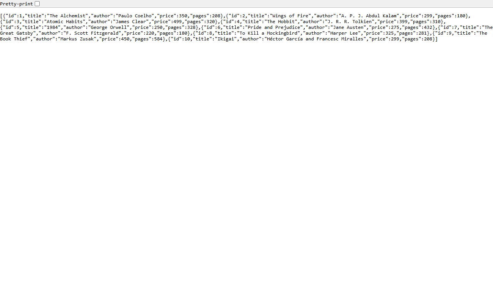
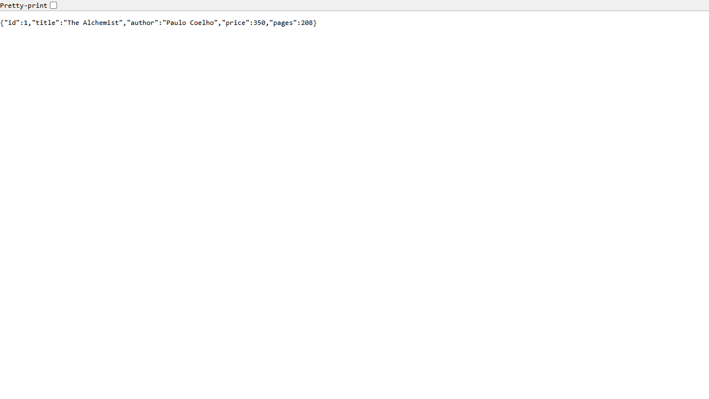
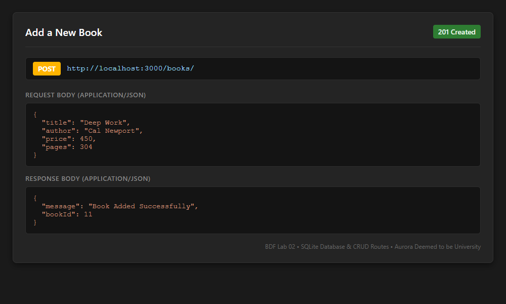
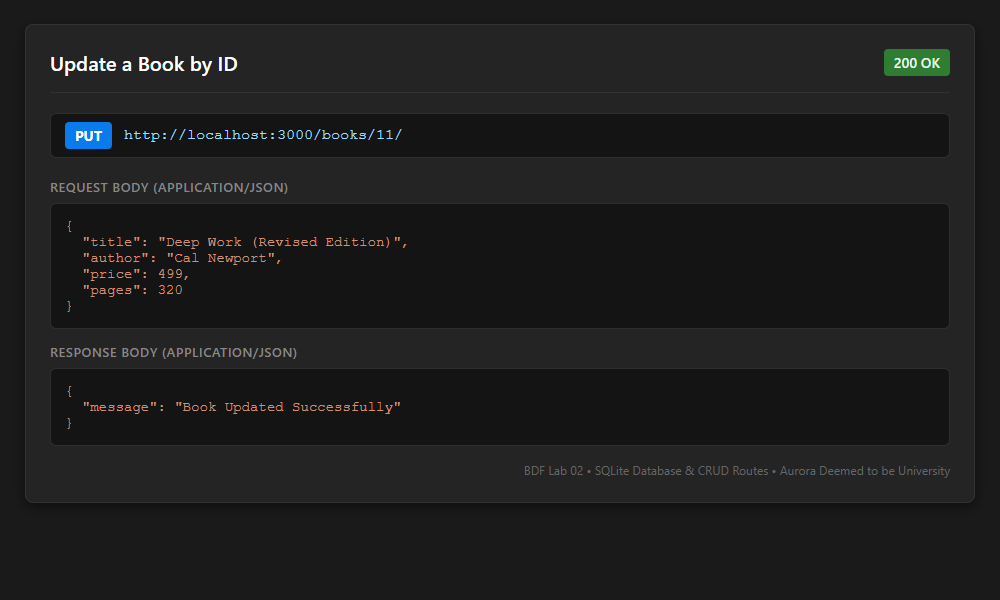
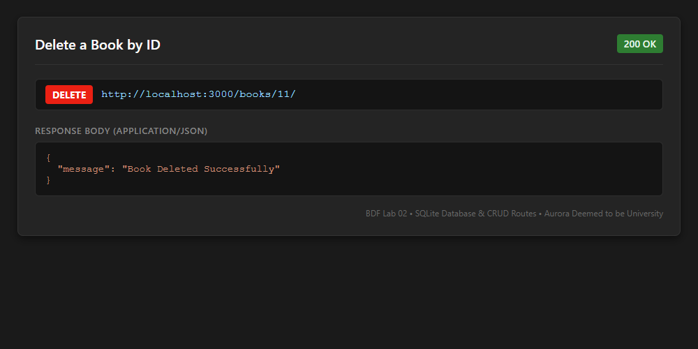
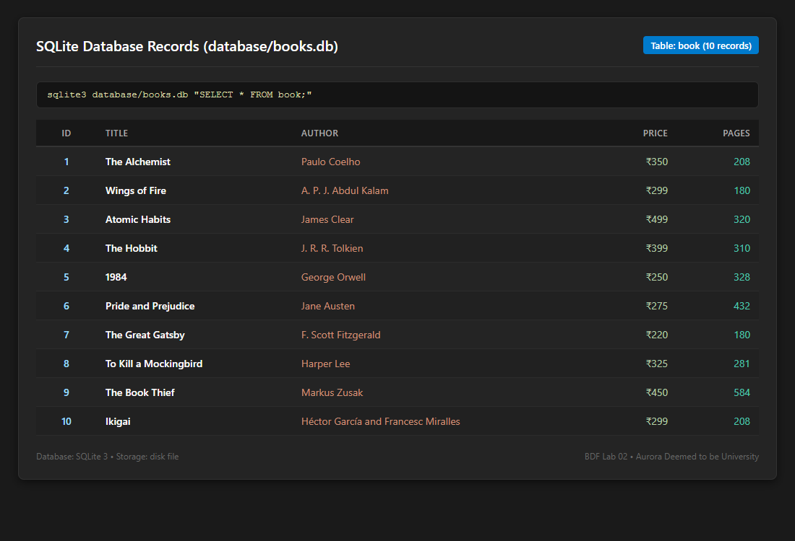

# Lab 2: SQLite database and CRUD routes

### Student Details
- **Student Name: TANINKI GOVINDA SAI KIRAN
- **Registration Number: 252U1R8092
- **Class:** B.Tech CSE(QE) – 2B
- **Section:** S-13 204 (CSE-QE-2B)
- **Course:** Backend Development Fundamentals (BDF)
- **Institution:** Aurora Deemed to be University

---

## Live Link
- **Deployed URL:** [https://backend-development-fundamentals-1-fzeu.onrender.com](https://backend-development-fundamentals-1-fzeu.onrender.com)
- **Deployment Platform:** Render (Web Service - Node.js)
- **GitHub Repository:** [https://github.com/GovindaSaiKiran/Backend_Development_Labs](https://github.com/GovindaSaiKiran/Backend_Development_Labs)

---

## Objective
Connect an Express server to a SQLite database and expose CRUD (Create, Read, Update, Delete) operations over HTTP.

---

## Technologies Used
- **Runtime:** Node.js
- **Web Framework:** Express.js
- **Database:** SQLite
- **Database Drivers:** `sqlite` and `sqlite3`
- **Development Tool:** Nodemon / Node `--watch`
- **API Testing:** Postman / cURL / PowerShell

---

## Project Setup and Execution

1. Open a terminal and navigate to the `lab-02` folder:
   ```bash
   cd lab-02
   ```

2. Install the project dependencies:
   ```bash
   npm install
   ```

3. Start the development server:
   ```bash
   npm run dev
   ```
   *(Or run production server via `npm start`)*

4. The server runs at:
   ```text
   http://localhost:3000
   ```

---

## Database Schema & Seed Data
The SQLite database file is located at `database/books.db`.

The `book` table contains the following columns:

| Column | Data Type | Description |
|---|---|---|
| `id` | `INTEGER` | Primary key, autoincrement |
| `title` | `TEXT` | Book title |
| `author` | `TEXT` | Book author |
| `price` | `INTEGER` | Book price in INR |
| `pages` | `INTEGER` | Number of pages |

The database is populated with 10 sample book records using the SQLite CLI and automated initialization script.

---

## API Endpoints / Scripts Table

### Available npm Scripts
| Script | Command | Purpose |
|---|---|---|
| `start` | `node server.js` | Starts the Express server |
| `dev` | `node --watch server.js` | Starts server in watch mode (auto restart on change) |

### RESTful CRUD Routes Table
| Method | Endpoint | Description | Status Code | Request Body / Params |
|:---:|---|---|:---:|---|
| **GET** | `/books/` | Retrieve all books from the database | `200 OK` | None |
| **GET** | `/books/:bookId/` | Retrieve a single book by its ID | `200 OK` / `404` | Route parameter `bookId` |
| **POST** | `/books/` | Add a new book to the database | `201 Created` | JSON `{ title, author, price, pages }` |
| **PUT** | `/books/:bookId/` | Update an existing book by its ID | `200 OK` / `404` | Route param `bookId` & JSON body |
| **DELETE** | `/books/:bookId/` | Delete a book by its ID | `200 OK` / `404` | Route parameter `bookId` |

*For `POST` and `PUT` requests, send a JSON body containing `title`, `author`, `price`, and `pages`.*

---

## Screenshots

### 1. Get all books


### 2. Get a book by ID


### 3. Add a book


### 4. Update a book


### 5. Delete a book


### 6. SQLite database records


---

## Problems Faced and Solutions

1. **Empty package.json Initialization:**
   - *Problem:* The initial `package.json` file was empty, preventing package installations.
   - *Solution:* Generated a valid JSON configuration with dependencies and start scripts before running `npm install`.

2. **SQLite Command-Line Tool & Driver Availability:**
   - *Problem:* The SQLite command-line tool was unavailable in the default execution path.
   - *Solution:* Programmatically initialized the schema and seed data using the Node.js `sqlite` and `sqlite3` driver libraries.

3. **Express Dependency Management:**
   - *Problem:* Express was initially missing from the project dependencies.
   - *Solution:* Installed it using `npm install express` and verified its entry in `package.json`.

4. **Port Binding for Cloud Deployment:**
   - *Problem:* Hardcoding port 3000 causes failures on cloud platforms where the port is dynamically assigned.
   - *Solution:* Utilized `process.env.PORT || 3000` to allow dynamic cloud port binding while supporting local testing on port 3000.

---

## Notes
- **SQL Parameterized Queries:** All SQL queries use `?` placeholders for user-provided values to prevent SQL injection vulnerabilities.
- **Asynchronous Database Connection:** The database connection is established asynchronously before the Express server begins listening on the network port.
- **Git Hygiene:** `node_modules/` and `.env` files are strictly excluded from version control using `.gitignore`.
